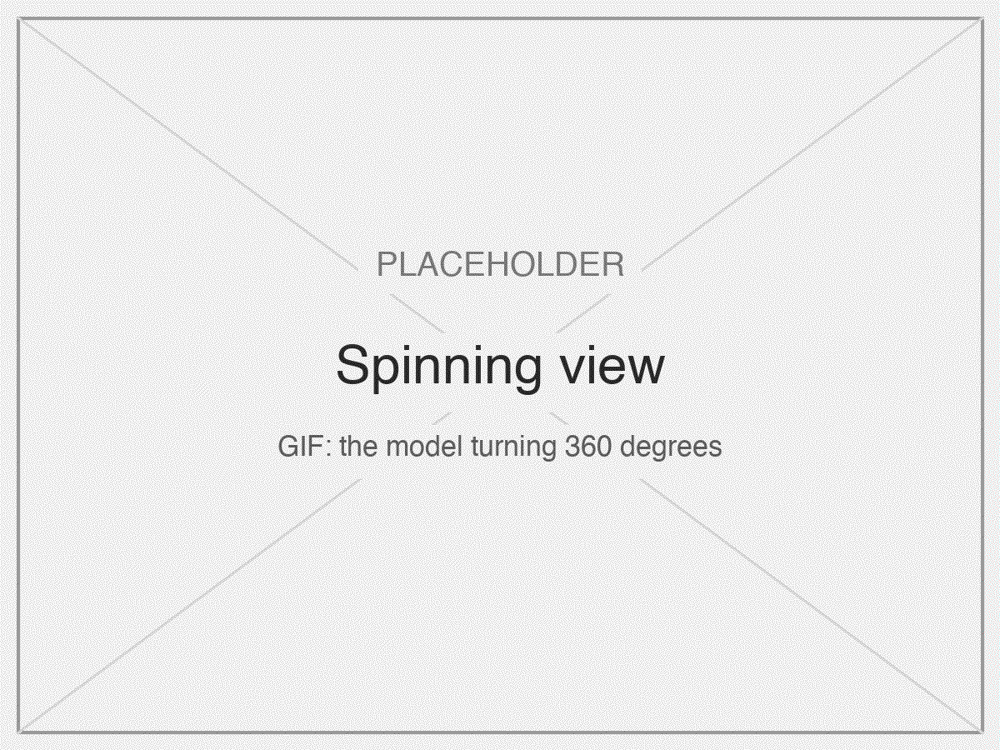
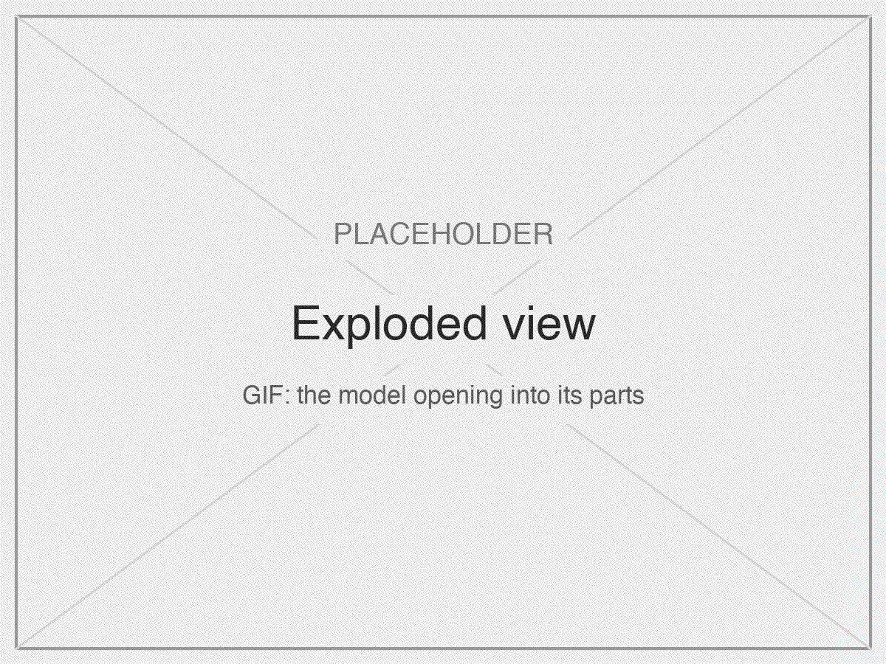
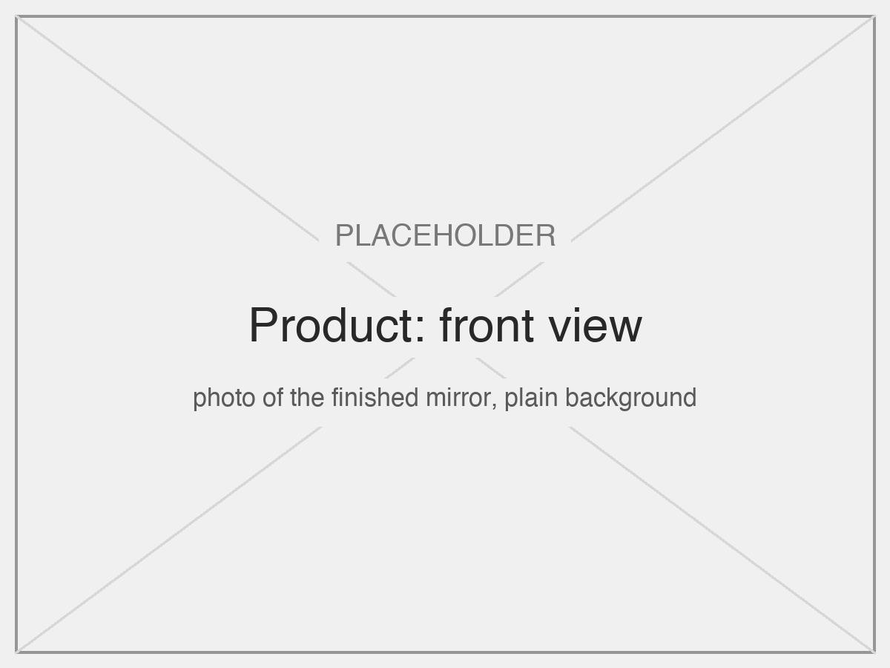
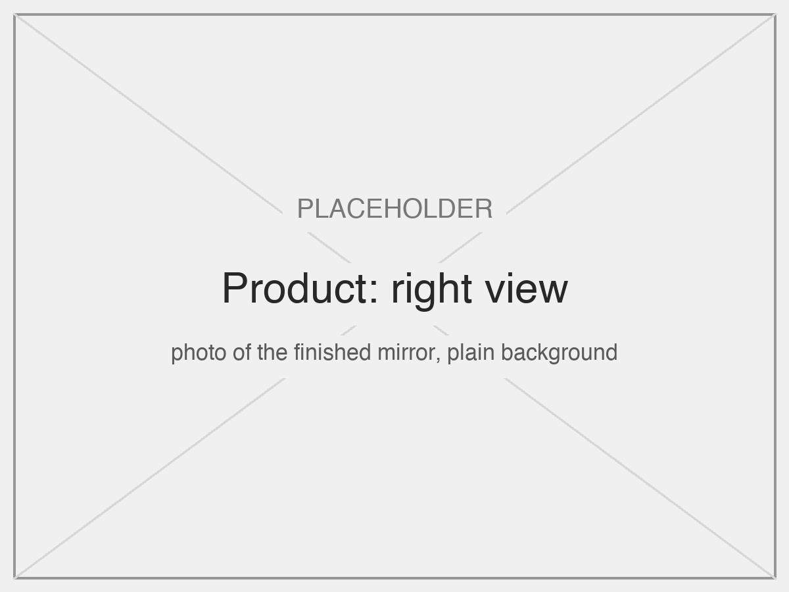
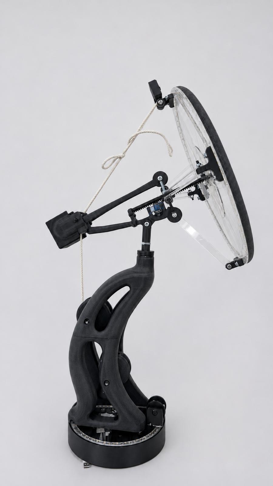
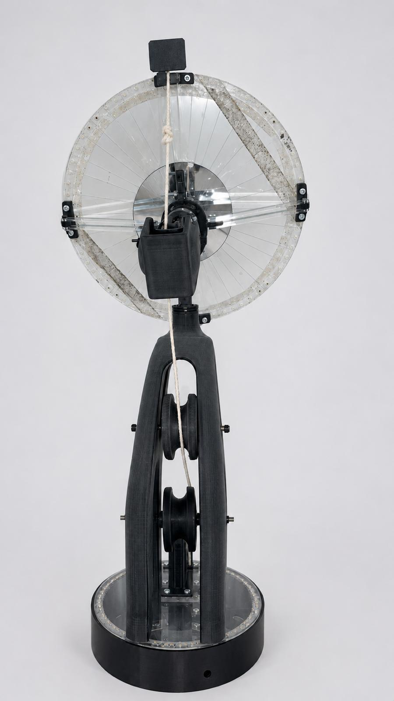
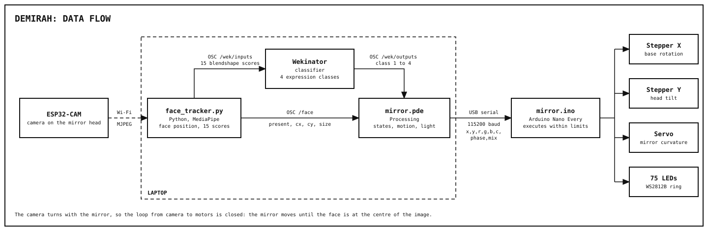
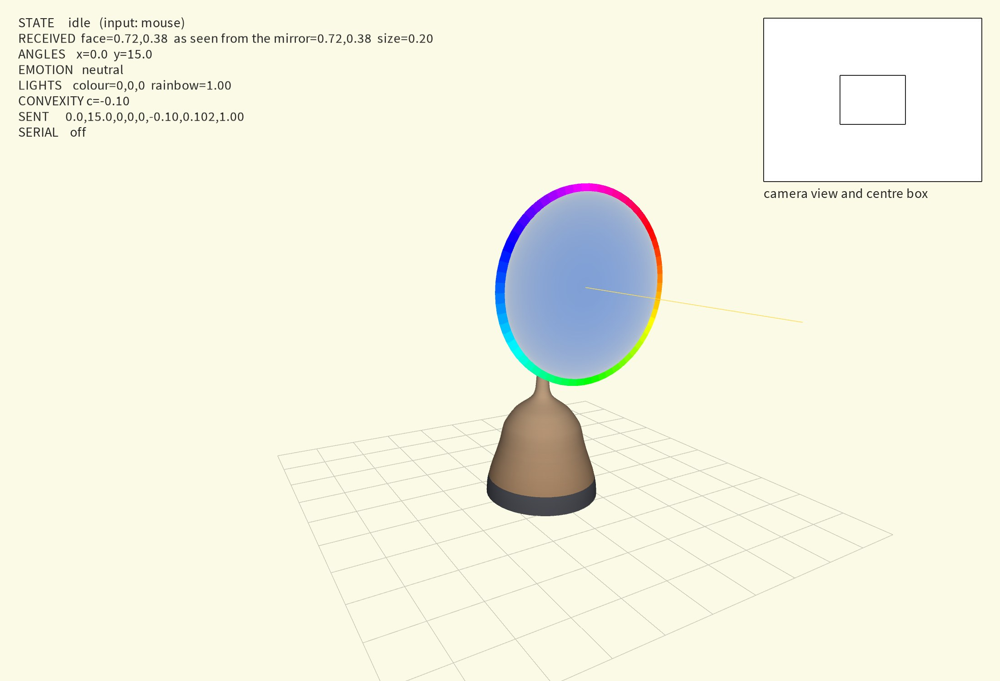
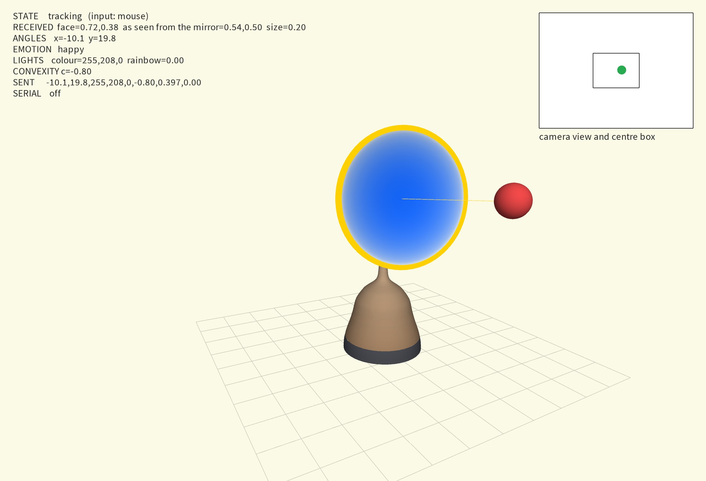

# Demirah: an interactive mirror

**Cyber Physical Systems, IDE 2026-27 (Imperial College London / Royal College of Art)**  
*Ruoxin Chen, Indiana Gothard, Giulio d'Angelantonio*

Demirah is a motorised mirror controlled by the user's face. A camera on the mirror tracks the face, and a machine learning model classifies its expression. The mirror rotates and tilts to keep the face centred, and changes the curvature of its surface and the colour of its LED ring according to the expression.

| Spinning view | Exploded view |
|---|---|
|  |  |

| Front | Right | Left | Back |
|---|---|---|---|
|  |  |  |  |

**Video of the demo:** 
https://github.com/user-attachments/assets/8ac95647-eb48-4d14-bd92-ed94be892471
## Interaction

The input is the position and expression of the user's face. The output is movement on three axes (rotation, tilt, surface curvature) and the colour of 75 LEDs. The user only needs to stand in front of the mirror, within 1 m.

| User input | System response | Reason |
|---|---|---|
| A face enters the image | The head traces one circle (2 s). LEDs turn yellow | Confirms the face was detected |
| The face moves | The mirror turns and tilts until the face is centred. It stays still while the face is inside a centre box (30% of the image) | Keeps the user in the reflection, without constant small corrections |
| Neutral expression | White LEDs, flat surface | The reference: an ordinary mirror |
| Smile | Yellow LEDs, the surface becomes concave | A concave mirror magnifies the reflection |
| Wink | Green LEDs, one short push of the surface (0.35 s) | A short input gets a short response |
| Amazed expression | Rainbow LEDs, the surface oscillates (4 s period) | The largest expression gets the largest movement |
| No face for 3 s | The head tilts down, the LEDs fade from blue to off, then the mirror goes back to idle | Shows that tracking has stopped and resets for the next user |

An expression shows after the classifier has reported it for 0.3 s. Every response can be repeated.

**Materials support the concept.** All motors and boards sit in the wide base, so the round head on its narrow neck moves freely and no mechanism is visible. The mirror surface is itself an actuator: a rack bends it from behind, so the response happens inside the reflection. Details in [mechanical.md](docs/mechanical.md).

## How it works



The camera turns with the mirror, so the offset of the face from the centre of the image is the pointing error, and the mirror moves until it is zero. This **closed loop** corrects motor and calibration errors automatically.

## Documentation

| Document | Contents |
|---|---|
| [Mechanical design](docs/mechanical.md) | Mechanisms, specifications, materials, assembly in 10 steps, design process |
| [Hardware design](docs/hardware.md) | Components, schematic, safety, power consumption |
| [Software design](docs/software.md) | Pipeline and why, key algorithms, sources |
| [Machine learning](docs/machine-learning.md) | Data, model, evaluation, training steps, improvements |
| [Calibration and troubleshooting](docs/calibration.md) | Setting up a new build, and finding a fault |

## Repository

| Folder | Contents |
|---|---|
| [`python/`](python) | `face_tracker.py`: camera, MediaPipe, OSC |
| [`processing/`](processing) | `mirror.pde`: the behaviour. `twin.pde`: the on-screen simulation |
| [`arduino/`](arduino) | `mirror/`: the sketch that runs the mirror. `calibration/`: a test sketch used only while building |
| [`esp32_cam/`](esp32_cam) | The camera's streaming sketch |
| [`tools/`](tools) | Scripts that draw the diagrams and evaluate the model |
| [`docs/`](docs) | Documentation and images |

## Running it

1. **Install** the Python packages, then the Processing library **oscP5** and the Arduino libraries **AccelStepper** and **Adafruit NeoPixel**:
   ```bash
   python3 -m venv .venv && .venv/bin/pip install -r python/requirements.txt
   ```
2. **Upload once:** `arduino/mirror/mirror.ino` to the Arduino Nano Every. For the camera, copy `secrets.example.h` to `secrets.h`, add the Wi-Fi details, and upload `esp32_cam/CameraWebServer` to the ESP32-CAM.
3. **Start, in this order:**
   1. Put the mirror at rest by hand (base centred, head down) and switch on the power board.
   2. Open the trained project in Wekinator and click **Run** (see [Training the model](#training-the-model)).
   3. Run `processing/mirror.pde`.
   4. Run the tracker: `.venv/bin/python python/face_tracker.py`

The system then runs without intervention.

### Training the model

The trained model is not in the repository: the brief asks only for its key parameters, in [machine-learning.md](docs/machine-learning.md). To train it:

1. Run the tracker. It sends 15 expression scores to port 6448 (`/wek/inputs`).
2. In Wekinator, create a project with **15 inputs**, and **1 output** of type classifier with **4 classes**, sent to port **12000** (`/wek/outputs`). Choose **k-nearest neighbour, k = 1**.
3. For each class (1 neutral, 2 happy, 3 wink, 4 amazed), press **Start recording**, hold the expression for a few seconds while moving your head and changing distance, then stop. Repeat with every person.
4. Press **Train**, then **Run**, then start `processing/mirror.pde`. The `EMOTION` line on screen shows the class received.

### Simulation

`mirror.pde` also draws a 3D simulation from the same values it sends to the Arduino. We used it to develop the behaviour without hardware. To use it, set `SIMULATION_ONLY = true` and `INPUT = "mouse"`: the mouse is the face, and keys 1-4 are the expressions.

| Idle | Tracking a smiling face |
|---|---|
|  |  |
