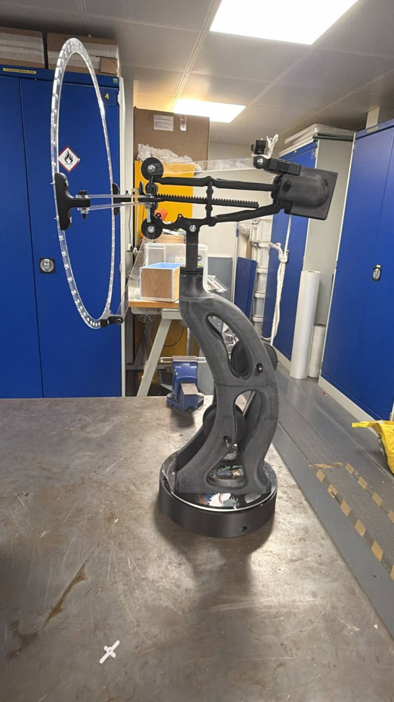
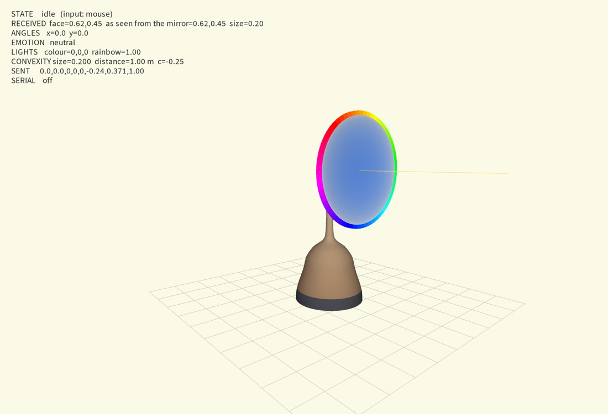
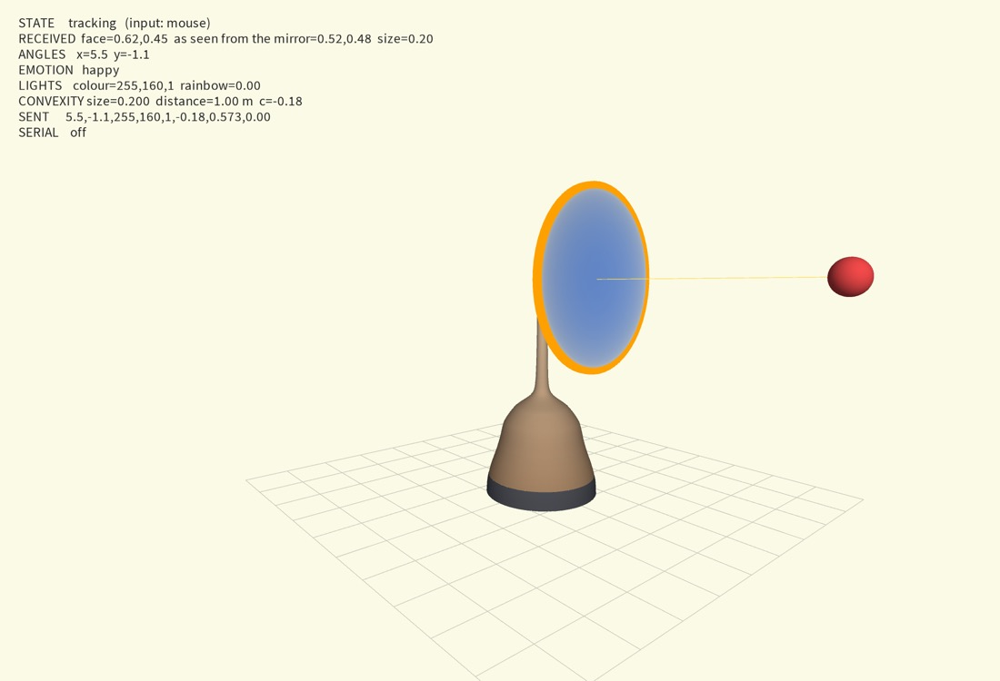

# Demirah: an interactive mirror

**Cyber Physical Systems, IDE (Imperial College London / Royal College of Art)**
Ruoxin Chen, Indiana Gothard, Giulio d'Angelantonio

Demirah is a round mirror that turns to face you, reads your expression and reacts. It greets you with a happy circle, follows your face, and answers your expression with the colour of its 75 LEDs and the shape of its surface: it goes concave when you smile, shakes when you frown, and swells when you blow at it. When you leave, it looks down sadly before going back to rest.

| The built model (mirror and LEDs not yet fitted) | Digital twin: idle | Digital twin: tracking |
|---|---|---|
|  |  |  |

**Video demo:** TODO, add a link (see [docs/media](docs/media/README.md)).

## How it works

```
ESP32-CAM on the mirror ~~Wi-Fi~~> face_tracker.py (MediaPipe)
                                     |- OSC /face --------------------------------> Processing
                                     '- OSC /wek/inputs -> Wekinator (5 classes) -> Processing
Processing (behaviour + digital twin) -- USB serial --> Arduino Nano Every
                                                        -> stepper X (rotation), stepper Y (tilt),
                                                           servo (concavity), 75 LEDs
```

The camera turns with the mirror, so the mirror keeps correcting until the face is in the centre of the image. This is a **closed loop**: motor and calibration errors correct themselves. While the face stays inside a **centre box** in the image, the mirror rests, so small movements do not disturb it.

| State | When | What the mirror does |
|---|---|---|
| idle | Nobody there | Rests. The surface pulses and a rainbow turns around the LEDs |
| greeting | A face appears | Draws a happy circle. LEDs turn orange |
| tracking | After greeting | Follows the face when it leaves the centre box. The LEDs and the surface show the emotion |
| sad | The face is gone | Looks down slowly. LEDs fade from blue to dark, then back to idle |

Expressions, recognised by Wekinator:

| Expression | LEDs | Surface |
|---|---|---|
| neutral | White | Flat |
| happy | Yellow | Goes concave |
| wink | Green | One quick push |
| angry | Red | Shakes |
| blow | Blue | Slowly pushes out to convex |

## Documentation

| Topic | Document | Rubric criterion |
|---|---|---|
| Concept and behaviour | This page | Overall concept |
| Mechanisms and structure | [docs/mechanical.md](docs/mechanical.md) | Mechanical design |
| Components, wiring, power | [docs/hardware.md](docs/hardware.md) | Hardware design |
| Pipeline and code | [docs/software.md](docs/software.md) | Software design |
| Training data and model | [docs/machine-learning.md](docs/machine-learning.md) | Machine learning |
| Calibration | [docs/calibration.md](docs/calibration.md) | Mechanical and hardware design |
| Debugging, step by step | [docs/debugging.md](docs/debugging.md) | Software and hardware design |

## Repository

| Folder | Contents |
|---|---|
| [`python/`](python) | `face_tracker.py`: camera, MediaPipe, OSC |
| [`wekinator/`](wekinator) | The trained 5-class project and its training data |
| [`processing/`](processing) | `mirror.pde` (behaviour) and `twin.pde` (digital twin) |
| [`arduino/mirror/`](arduino/mirror) | `mirror.ino`: motors, servo and LEDs |
| [`esp32_cam/`](esp32_cam) | The ESP32-CAM streaming sketch |
| [`tools/`](tools) | Hardware calibration sketch, and the script that draws the circuit diagram |
| [`docs/`](docs) | Documentation and media |

## Quick start

1. **Install:**
   ```bash
   python3 -m venv .venv && .venv/bin/pip install -r python/requirements.txt
   ```
   Then install the Processing library **oscP5**, and the Arduino libraries **AccelStepper** and **Adafruit NeoPixel**.
2. **Upload:** put `arduino/mirror/mirror.ino` on the Arduino Nano Every. For the camera, copy `esp32_cam/CameraWebServer/secrets.example.h` to `secrets.h`, fill in the Wi-Fi details, then upload the sketch to the ESP32-CAM.
3. **Start, in this order:**
   1. The power board.
   2. Wekinator: open the trained project (see [machine-learning.md](docs/machine-learning.md)) and click **Run**.
   3. `processing/mirror.pde`.
   4. The tracker:
      ```bash
      .venv/bin/python python/face_tracker.py
      ```
      Add `--laptop` to use the computer's camera instead.

To try it without hardware, set `SIMULATION_ONLY = true` and `INPUT = "mouse"` in `mirror.pde`.
