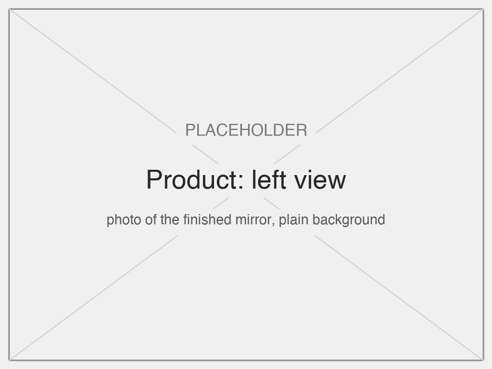
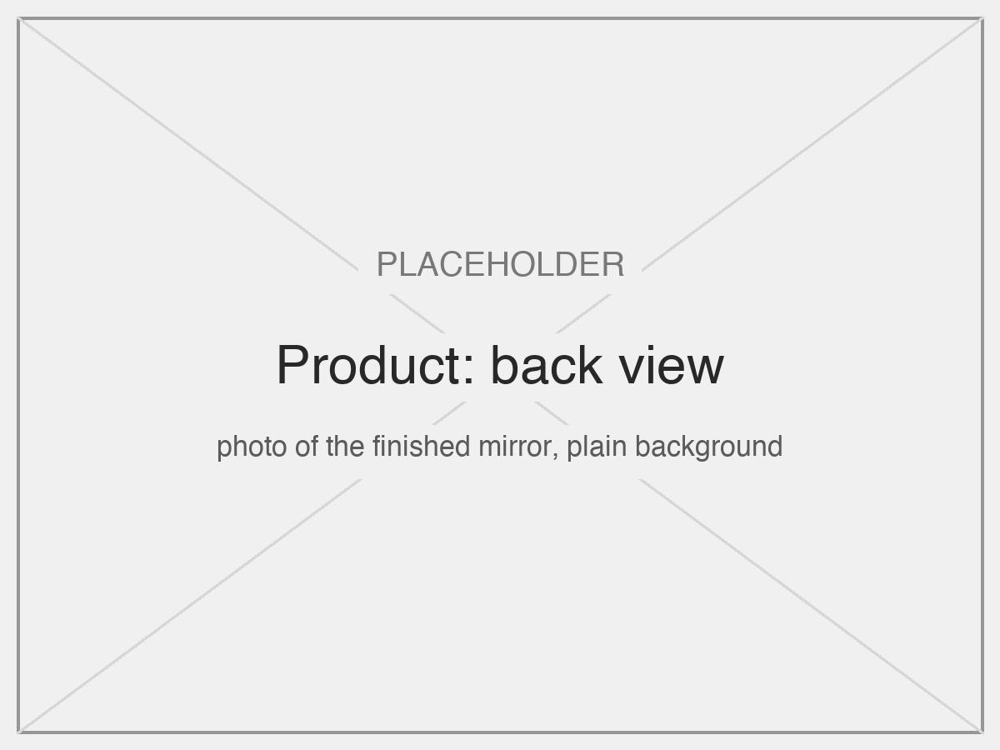

# Demirah: an interactive mirror

**Cyber Physical Systems, IDE 2026-27 (Imperial College London / Royal College of Art)**  
*Ruoxin Chen, Indiana Gothard, Giulio d'Angelantonio*

Demirah is a mirror that behaves like a small creature. It turns to face you, greets you, and answers your expression with light and with the shape of its own surface. When you leave, it lowers its head and goes back to rest.

| Spinning view | Exploded view |
|---|---|
|  |  |

## The product

| Front | Right | Left | Back |
|---|---|---|---|
|  |  |  |  |

**Video of the demo:** TODO, add the link.

## Concept

A normal mirror is passive: it shows you and does nothing. Demirah gives the reflection a will of its own. The input is your **face**: where it is and what it expresses. The output is **movement**: the mirror turns and tilts to keep you in view, and bends its surface so that your own reflection changes with your mood.

The input and the output are the same object. You look at a mirror to see your face, so the face is the natural way to control it, and the answer appears in the place you are already looking.

### Interaction

| You | The mirror | Why |
|---|---|---|
| Walk up to it | Draws one happy circle with its head. LEDs turn yellow | A greeting shows it has noticed you before anything else happens |
| Move around | Turns and tilts to follow your face. It rests while you stay near the centre | Following proves it is looking at *you*. Resting for small movements keeps it calm, not nervous |
| Keep a neutral face | White LEDs, flat surface | A plain mirror: the baseline that every reaction is compared with |
| Smile | Yellow LEDs, the surface goes concave | A concave mirror magnifies, so your smile grows |
| Wink | Green LEDs, one quick push of the surface | A wink is short, so the answer is one short gesture: the mirror winks back |
| Look amazed | Rainbow LEDs, the surface pulses in and out | The most surprised face gets the most lively answer |
| Walk away | Lowers its head, blue light fades out, then it returns to rest | It makes the end of the interaction visible, and invites you back |

Every reaction happens within a second, and each one can be repeated as often as you like, so people discover the expressions by trying.

### Materials and construction

| Choice | How it supports the concept |
|---|---|
| A round mirror on a slim neck | It reads as a head on a body, so its movements read as gestures |
| An organic, curved 3D-printed body | Soft shapes make it a creature, not a machine. The motors and electronics are hidden in the base |
| A flexible mirror, pushed from behind | The surface itself moves, so the reaction happens inside your reflection |
| LEDs hidden behind an acrylic ring | The light glows around the face like a mood, with no visible lamps |
| The camera on the head | The mirror "sees" from where it looks, which also makes the tracking simple and exact |

## How it works

```
ESP32-CAM on the mirror ~~Wi-Fi~~> face_tracker.py (MediaPipe)
                                     |- OSC /face --------------------------------> Processing
                                     '- OSC /wek/inputs -> Wekinator (4 classes) -> Processing
Processing (behaviour) -- USB serial --> Arduino Nano Every
                                         -> stepper X (rotation), stepper Y (tilt),
                                            servo (curvature), 75 LEDs
```

The camera turns with the mirror, so the mirror keeps correcting until the face is in the centre of the image. This is a **closed loop**: motor and calibration errors correct themselves.

| State | When | What the mirror does |
|---|---|---|
| idle | Nobody there | Looks straight ahead. The surface pulses and a rainbow turns around the LEDs |
| greeting | A face appears | Draws a happy circle. LEDs turn yellow |
| tracking | After greeting | Follows the face when it leaves the centre box. LEDs and surface show the expression |
| sad | The face is gone | Looks down slowly. LEDs fade from blue to dark, then back to idle |

## Documentation

| Document | Contents | Rubric criterion |
|---|---|---|
| This page | Purpose, interaction, materials, photos | Overall concept |
| [docs/mechanical.md](docs/mechanical.md) | Mechanisms, materials, fabrication, design process | Mechanical design |
| [docs/assembly.md](docs/assembly.md) | Assembly in 10 steps | Mechanical design |
| [docs/hardware.md](docs/hardware.md) | Components, schematic, power | Hardware design |
| [docs/software.md](docs/software.md) | Pipeline, code, sources | Software design |
| [docs/machine-learning.md](docs/machine-learning.md) | Data, model, evaluation, improvements | Machine learning |
| [docs/calibration.md](docs/calibration.md) | Calibration, step by step | Hardware and software |
| [docs/debugging.md](docs/debugging.md) | Finding a fault, step by step | Hardware and software |

## Repository

| Folder | Contents |
|---|---|
| [`python/`](python) | `face_tracker.py`: camera, MediaPipe, OSC |
| [`processing/`](processing) | `mirror.pde` (behaviour) and `twin.pde` (on-screen simulation) |
| [`arduino/mirror/`](arduino/mirror) | `mirror.ino`: the one sketch that runs the mirror |
| [`esp32_cam/`](esp32_cam) | The ESP32-CAM streaming sketch |
| [`tools/`](tools) | A hardware calibration sketch, and the script that draws the schematic |
| [`docs/`](docs) | Documentation and media |

## Running it

1. **Install:**
   ```bash
   python3 -m venv .venv && .venv/bin/pip install -r python/requirements.txt
   ```
   Then install the Processing library **oscP5**, and the Arduino libraries **AccelStepper** and **Adafruit NeoPixel**.
2. **Upload once:** put `arduino/mirror/mirror.ino` on the Arduino Nano Every. For the camera, copy `esp32_cam/CameraWebServer/secrets.example.h` to `secrets.h`, fill in the Wi-Fi details, then upload the sketch to the ESP32-CAM.
3. **Start, in this order:**
   1. Put the mirror at rest by hand (base centred, head down), then switch on the power board.
   2. Wekinator: open the trained project and click **Run** (see [machine-learning.md](docs/machine-learning.md)).
   3. Processing: run `processing/mirror.pde`.
   4. The tracker:
      ```bash
      .venv/bin/python python/face_tracker.py
      ```

From then on the mirror runs by itself: there is nothing to press and no sketch to change.

### Digital simulation

The Processing sketch also draws a simulation of the mirror, used to develop and test the behaviour without the hardware. It is a tool, not the product. To use it, set `SIMULATION_ONLY = true` and `INPUT = "mouse"` in `mirror.pde`: the mouse is the face, and the keys 1-4 are the expressions.

| Simulation: idle | Simulation: tracking a smiling face |
|---|---|
|  |  |
