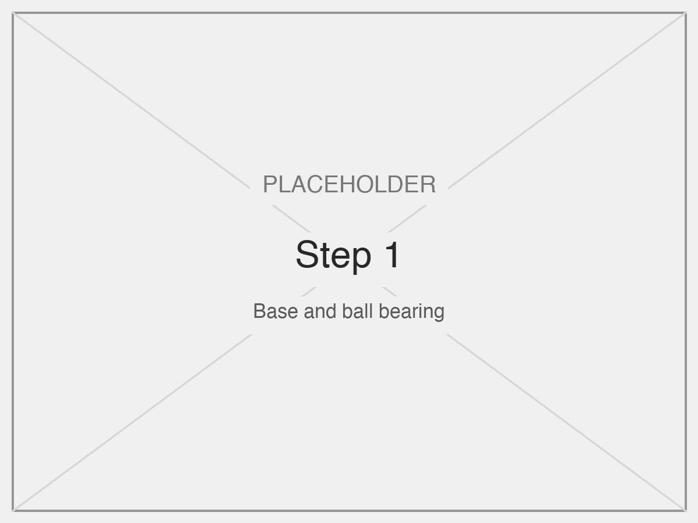
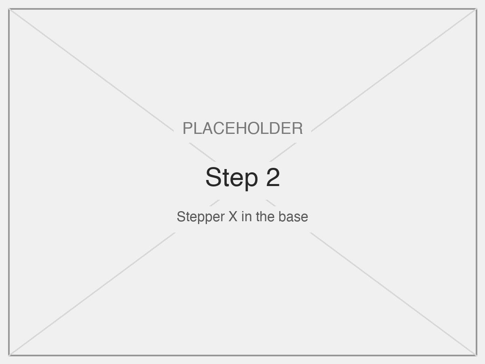
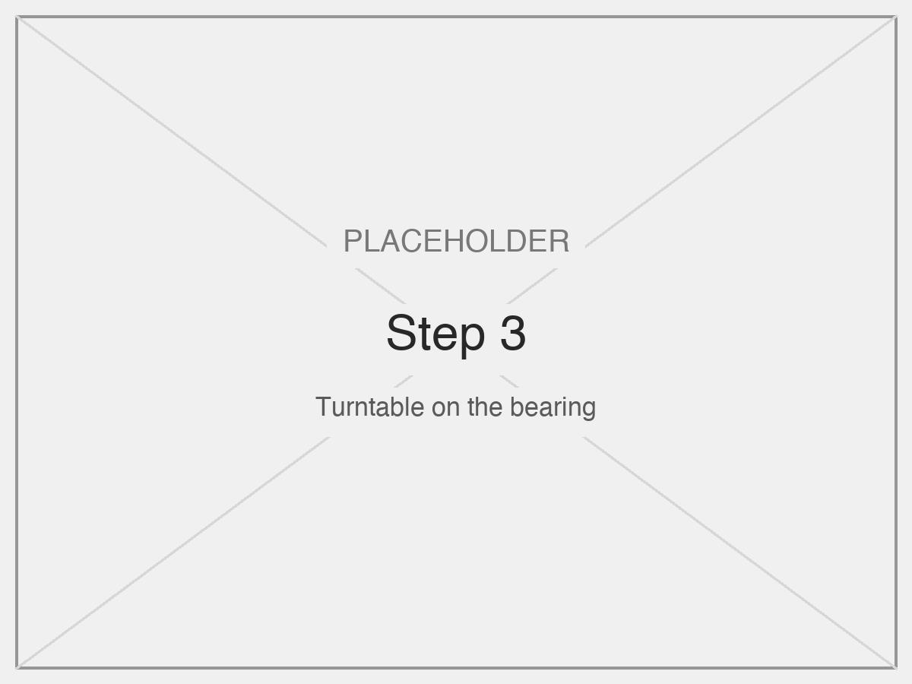
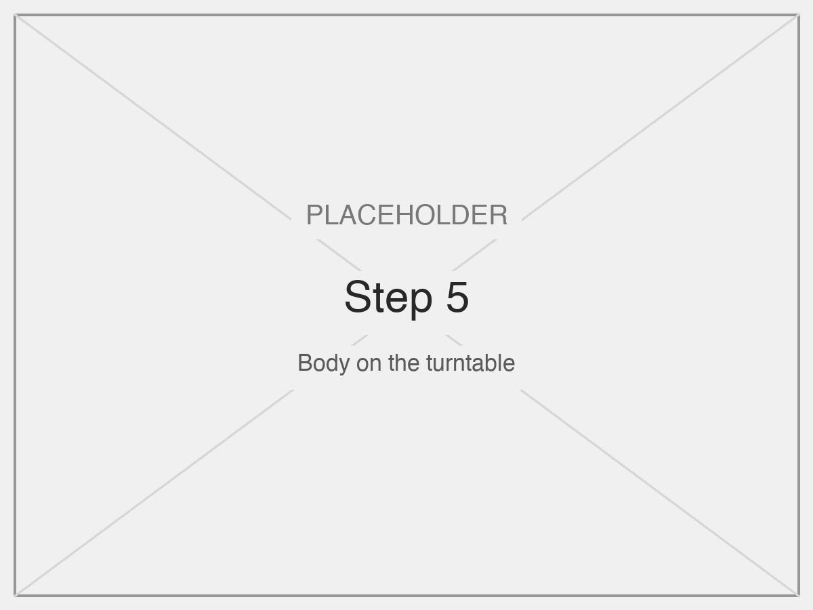
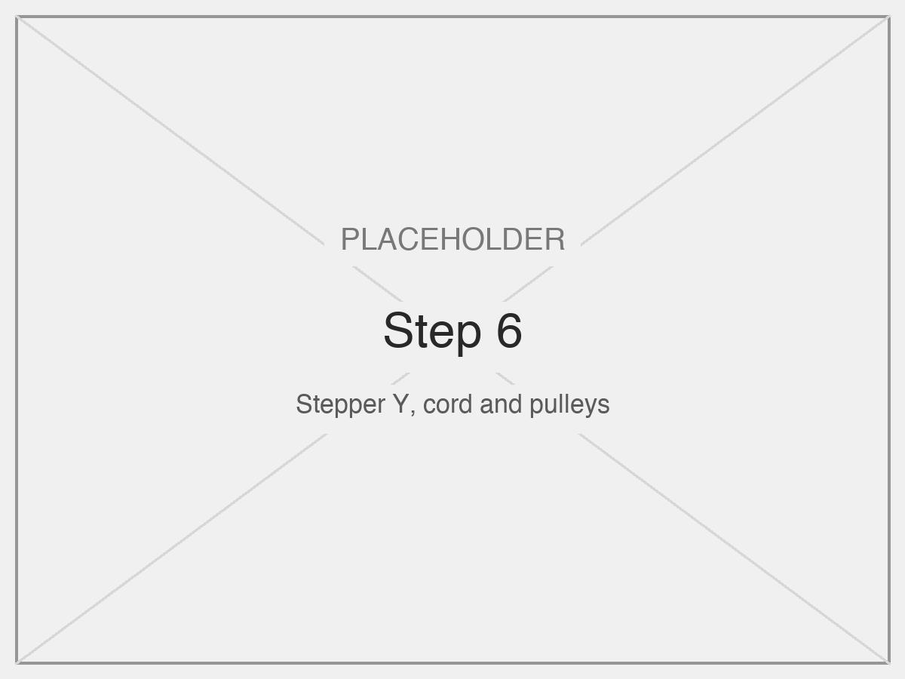
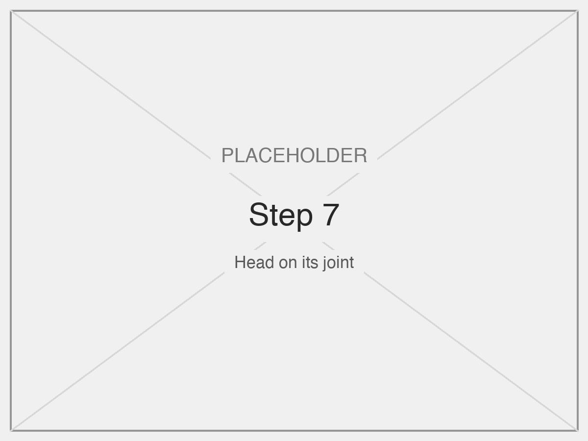
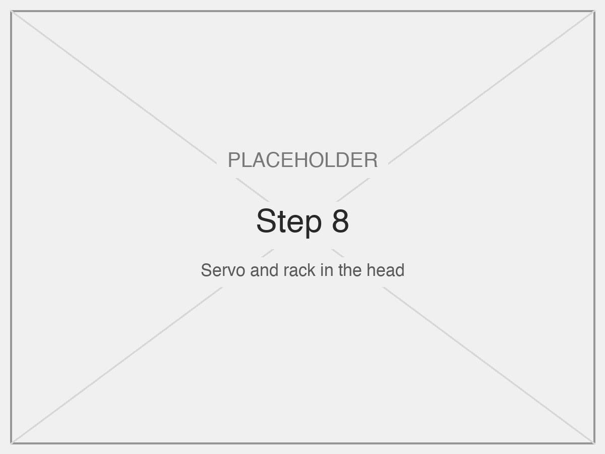
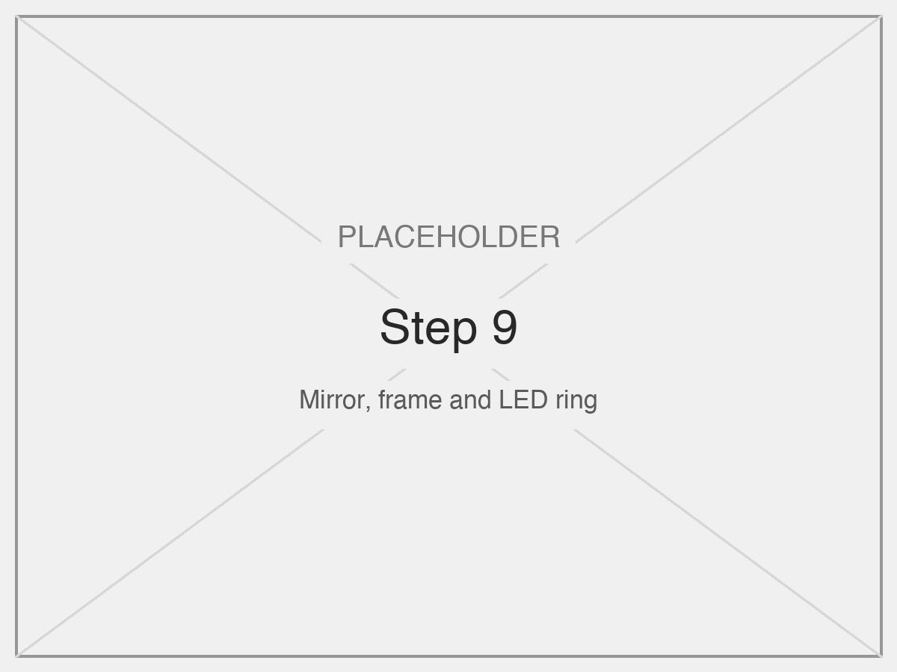
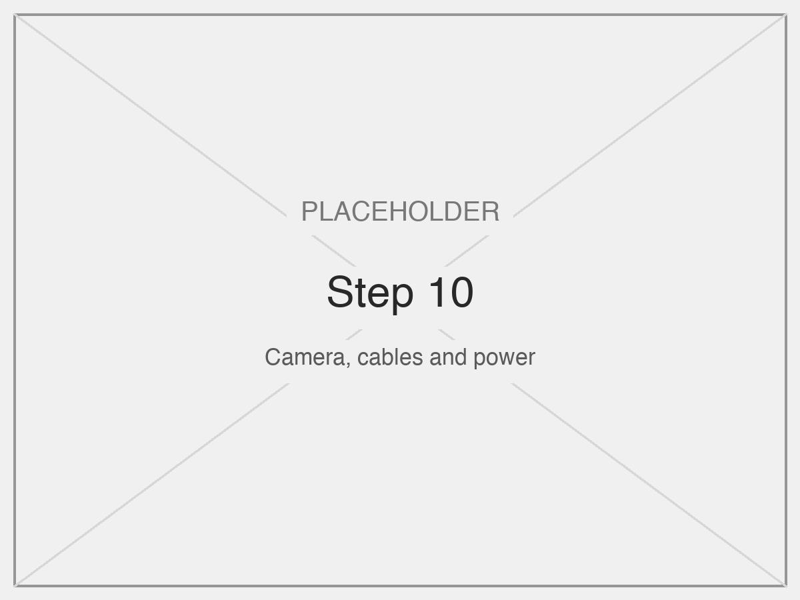

# Assembly

Ten steps, from the base up. The parts are listed in [mechanical.md](mechanical.md) and [hardware.md](hardware.md), and the wiring is in the [schematic](circuit.svg).

**Tools:** small cross-head screwdriver, soldering iron, hot glue or cable ties.

| | |
|---|---|
| **1. Base and bearing**  Place the lower bearing ring in the base and fill its groove with the steel balls. | **2. Stepper X**  Fix stepper X in its seat in the base, with its shaft pointing up at the centre. |
| **3. Turntable**  Lower the upper bearing ring onto the balls and couple it to the shaft of stepper X. Turn it by hand: it must spin freely. | **4. Electronics**  Fix the Arduino, the two stepper drivers and the power board in the base. Plug stepper X into its driver. |
| **5. Body**  Fix the body to the turntable. Leave the cables for the head hanging through its centre. | **6. Stepper Y, cord and pulleys**  Fit stepper Y and its spool. Thread the cord over the two pulleys inside the body, up to the top. |
| **7. Head**  Mount the head on its joint and tie the cord to it. With the cord slack, the head rests fully down. | **8. Servo and rack**  Fix the servo in the head and slide the rack onto its gear, so the rack points at the centre of the mirror. |
| **9. Mirror, frame and LEDs**  Lay the LED strip around the head, place the mirror, and clamp its rim with the acrylic ring. The rack touches the back of the mirror at its centre. | **10. Camera, cables and power**  Fix the ESP32-CAM on the head. Connect everything as in the schematic, tidy the cables with slack for the full rotation, and plug in the power bank. |

## After assembly

1. Check by hand that the base turns 80° each way without pulling a cable.
2. Follow [calibration.md](calibration.md) to set the limits, speeds and servo positions.
3. Follow the start-up order in the [README](../README.md#running-it).
