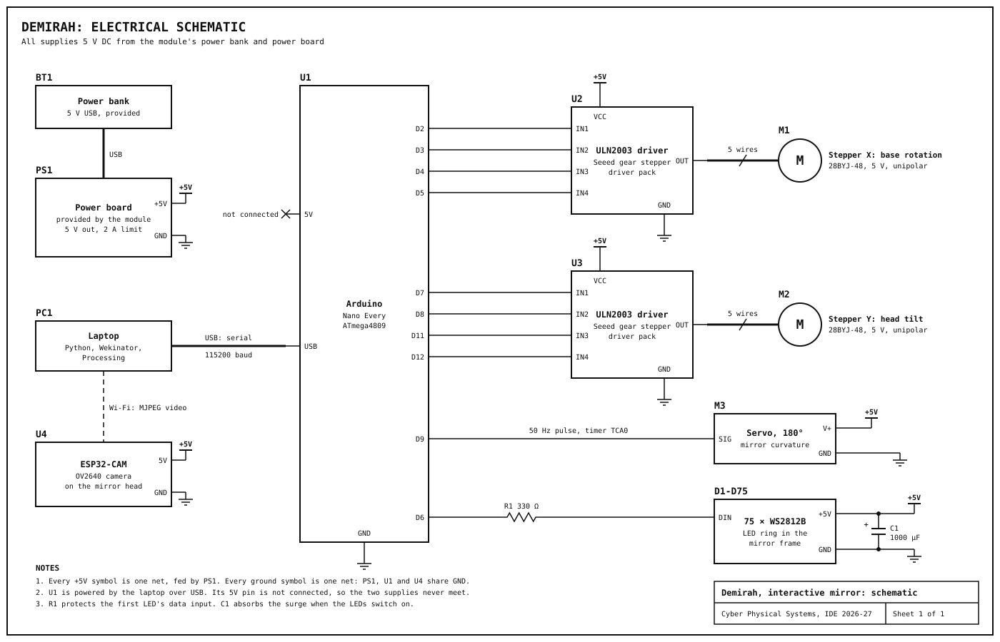

# Hardware design

Everything runs on **5 V DC** from the module's power bank and power board: no mains power and no voltage above 5 V.

## Components

| Ref | Component | Task | Why |
|---|---|---|---|
| U1 | Arduino Nano Every | Receives one line of text from the laptop and drives all actuators | Small, 5 V logic, enough pins. Its hardware timer makes a servo pulse that LED updates cannot disturb |
| M1, U2 | 5 V geared stepper (28BYJ-48) + ULN2003 driver | Rotates the body | Exact, repeatable positions without an encoder. Its gearbox gives torque and holds position |
| M2, U3 | 5 V geared stepper (28BYJ-48) + ULN2003 driver | Winds the tilt cord | Same part as M1. Its high gear ratio lifts the head from 5 V |
| M3 | 180° micro servo | Bends the mirror through the rack | Light enough for the head, fast, one signal wire |
| D1-D75 | 75 × WS2812B LEDs | Light around the mirror | Each LED is set separately over one wire, which allows the rainbow and fades |
| U4 | ESP32-CAM (OV2640) | Streams video from the head over Wi-Fi | No data cable has to cross the moving joints |
| R1 | 330 Ω resistor | On the LED data line | Protects the first LED's input from spikes |
| C1 | 1000 µF capacitor | Across the LED supply | Absorbs the surge when the LEDs switch on |
| PS1, BT1 | Power board and power bank (module) | 5 V supply, 2 A current limit | Portable, and keeps the motor current off the laptop's USB port |

## Schematic

Drawn by [`tools/circuit_diagram.py`](../tools/circuit_diagram.py). The pins are constants at the top of [`mirror.ino`](../arduino/mirror/mirror.ino). D9 is fixed: it is the output of the timer that makes the servo pulse.

## Safety and robustness

- **5 V only**, from the provided power bank through the provided power board, which limits the current to 2 A.
- **No back-feeding.** The Arduino is powered by the laptop over USB, and its 5V pin is not connected to the power board. All grounds are shared.
- **Software limits.** The Arduino never moves a motor past its calibrated range, whatever it receives, so a fault cannot pull a cable. LED brightness is capped at 60/255.
- **Few wires on moving parts.** Both steppers and all boards are in the fixed base. Only the servo, the LEDs and the camera ride on the head, and the video goes over Wi-Fi. The head cables run through the centre of the body, close to the rotation axis, with slack for 80° each way.

## Power consumption

| Load | Estimate at 5 V |
|---|---|
| Stepper X | 0.2 A while moving, 0 at rest |
| Stepper Y | 0.2 A, always on to hold the head |
| Servo | 0.15 A moving, up to 0.65 A if blocked |
| ESP32-CAM | 0.2 A, peaks of 0.3 A |
| 75 LEDs at brightness 60/255 | 0.35 A in colour or rainbow, 1.06 A in full white |
| **Typical (tracking a face)** | **about 1.1 A**, half of the 2 A limit |
| **Worst case** | **about 2.4 A**: white LEDs, blocked servo, both steppers. The power board's limit protects against it |

The Arduino draws about 0.05 A from the laptop. A 10 000 mAh power bank runs the typical load for 5 to 6 hours.
