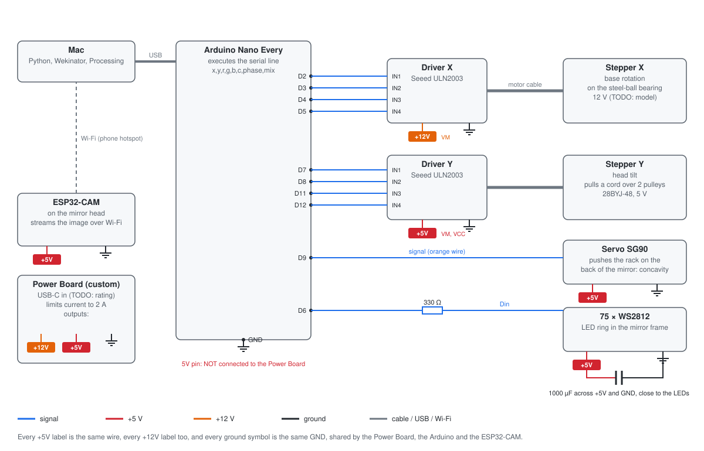

# Hardware design

Everything runs on **5 V DC** from the module's power bank and power board. There is no mains power and no voltage above 5 V.

## Components

The references (U1, M1...) match the schematic below.

| Ref | Component | Qty | Task | Why we chose it |
|---|---|---|---|---|
| U1 | Arduino Nano Every | 1 | Receives one line of text from the laptop and drives the motors, servo and LEDs | Small enough for the base, 5 V logic, and enough pins. Its hardware timer makes a servo pulse that the LED updates cannot disturb |
| M1, U2 | 5 V geared stepper (28BYJ-48) with its ULN2003 driver | 1 | Rotates the body | Exact, repeatable positions without an encoder. Its gearbox gives the torque to turn the body and holds it when stopped |
| M2, U3 | 5 V geared stepper (28BYJ-48) with its ULN2003 driver | 1 | Winds the cord that tilts the head | The same part as M1, so one driver type and one library. Its high gear ratio lifts the head from a 5 V supply |
| M3 | 180° micro servo | 1 | Pushes the rack: mirror curvature | Light enough to ride in the head, fast enough for gestures, and it needs one signal wire |
| D1-D75 | WS2812B addressable LEDs | 75 | Light around the mirror | Each LED is set separately over one data wire, which makes the turning rainbow and the smooth fades possible |
| U4 | ESP32-CAM (OV2640 camera) | 1 | Films the person and streams the video over Wi-Fi | Wireless, so the camera can ride on the moving head with only two power wires |
| R1 | 330 Ω resistor | 1 | In series with the LED data wire | Protects the first LED's input from spikes on the data line |
| C1 | 1000 µF capacitor | 1 | Across the LEDs' 5 V and GND | Absorbs the current surge when the LEDs switch on |
| PS1 | Power board (module) | 1 | Distributes 5 V and limits the current to 2 A | Keeps the motor and LED current off the laptop's USB port, with a current limit for safety |
| BT1 | Power bank (module) | 1 | 5 V supply | Makes the mirror portable and independent of mains power |
| PC1 | Laptop | 1 | Runs Python, Wekinator and Processing | Required by the pipeline (see [software.md](software.md)) |

## Schematic

The schematic is drawn by [`tools/circuit_diagram.py`](../tools/circuit_diagram.py), so it always matches the pin numbers below.

| Part | Arduino pin | Power |
|---|---|---|
| U2 (stepper X driver), IN1-IN4 | D2, D3, D4, D5 | +5V, GND |
| U3 (stepper Y driver), IN1-IN4 | D7, D8, D11, D12 | +5V, GND |
| M3 (servo), signal | D9 | +5V, GND |
| D1-D75 (LEDs), data in, through R1 | D6 | +5V, GND, with C1 across them |
| U4 (ESP32-CAM) | none: it talks over Wi-Fi | `5V` pin and GND |

D9 is fixed: it is the output of the timer that makes the servo pulse. The pin numbers are constants at the top of [`mirror.ino`](../arduino/mirror/mirror.ino).

## Powering safely

- **5 V only.** Every part is rated for 5 V, and the only source is the provided power bank through the provided power board.
- **Current limit.** The power board limits the current to 2 A.
- **Shared ground.** The power board, the Arduino and the ESP32-CAM share GND, so every signal has the same reference.
- **No back-feeding.** The Arduino is powered by the laptop over USB, and its 5V pin is not connected to the power board. The two supplies never push against each other.
- **LED brightness cap.** `MAX_BRIGHTNESS = 60` (out of 255) in `mirror.ino` limits the LED current in software.
- **Motors that rest.** Stepper X switches its coils off 2 s after it stops.
- **Software limits.** The Arduino never moves a motor past its calibrated range, whatever it receives, so a software fault cannot pull a cable.

## Built to move

The head turns 160° and tilts 30°, so the wiring is made to move with it.

- **Few wires cross the joints.** Only the servo, the LED strip and the camera are on the head: three power pairs and two signal wires. Both steppers and all boards stay in the base, which does not move.
- **Wireless camera.** The video travels over Wi-Fi, so no data cable has to bend.
- **Slack for the full rotation.** The cables to the head run through the centre of the body, close to the axis of rotation, with enough slack for 80° each way. The software limits keep the rotation inside that slack.
- **Fixed boards.** The Arduino, drivers and power board are fixed inside the base, and their connectors do not carry any weight.
- TODO: describe how the joints are made (soldered and heat-shrunk, or connectors) and add a photo of the wiring.

## Power consumption

| Load | Estimate at 5 V | Basis |
|---|---|---|
| Stepper X (M1) | 0.2 A while moving, 0 A at rest | Two 50 Ω coils on at a time |
| Stepper Y (M2) | 0.2 A, always on | It holds the head against gravity |
| Servo (M3) | 0.15 A moving, up to 0.65 A if blocked | Typical for a micro servo |
| ESP32-CAM (U4) | 0.2 A, with peaks of 0.3 A | Wi-Fi streaming |
| 75 LEDs at `MAX_BRIGHTNESS = 60` | 0.35 A for the rainbow or one colour, 1.06 A for full white | 75 × 60 mA × 60/255 for white. A single colour or the rainbow lights about one third of the LED channels |
| **Typical total** | **about 1.1 A** | Tracking a face: both steppers, servo, camera and coloured LEDs |
| **Worst case** | **about 2.4 A** | Everything at once: white LEDs, a blocked servo and both steppers. Above the 2 A limit |

The typical load is about half of the 2 A limit. The worst case can only happen in neutral (white LEDs) with a blocked servo, and the power board's limit protects against it. A 10 000 mAh power bank would run the typical load for 5 to 6 hours (TODO: confirm the capacity of the provided power bank).

The Arduino is not in this table: it draws about 0.05 A from the laptop's USB port.

## Reproducing it

1. Print and cut the parts ([mechanical.md](mechanical.md)), then follow [assembly.md](assembly.md).
2. Wire the parts as in the schematic.
3. Upload [`mirror.ino`](../arduino/mirror/mirror.ino) and the camera sketch (see the [README](../README.md#running-it)).
4. Calibrate with [calibration.md](calibration.md). If something does not work, follow [debugging.md](debugging.md).
