# Mechanical design

Demirah is a new mechanical system, not a modified DE-Arm. The task needs two rotation axes that carry a mirror and a third actuator that bends the mirror surface, which a serial arm with a gripper does not provide.

| | DE-Arm (starting point) | Demirah |
|---|---|---|
| Actuators | 4 hobby servos, one per joint | 2 geared steppers for the large movements, 1 servo for the surface |
| Positioning | Limited to 180° per joint | 50 steps per degree on the base, 160° of travel, holds position without power |
| Load | Each servo carries the joints after it | Both steppers are in the base: the head carries only the mirror, the servo and the camera |

## Mechanisms

| Motion | Actuator | Mechanism | Why |
|---|---|---|---|
| Rotation | Stepper X, in the base | The body sits on a ball bearing: steel balls between two printed rings | Carries the body without wobbling and with little friction, so a small 5 V stepper is enough |
| Tilt | Stepper Y, in the base | The stepper winds a cord over **two pulleys** inside the body, up to the head. Gravity lowers the head, the cord lifts it | The motor's weight stays low. The cord is always under tension, so there is no backlash |
| Surface | Servo, in the head | The servo drives a **rack** that pushes the centre of the mirror while the ring holds its rim | Pushing the centre bends the sheet into a curve. A servo is fast enough for short gestures |

There are no end stops: the position at power-on counts as zero, and software limits stop the motion.

## Specifications

| | |
|---|---|
| Rotation | 160° (80° each way), 50 steps per degree, up to 16°/s |
| Tilt | 30°, 250 steps per degree, up to 2.8°/s. The high reduction lets a 5 V stepper lift the head, at the cost of speed |
| Surface | Concave to convex over a 1000 µs change of the servo pulse |
| Size | Fits the 605 × 370 × 280 mm project box |

## Materials and fabrication

| Part | Material and process | Why |
|---|---|---|
| Base | 3D-printed PLA | Exact seats for the stepper and the bearing races, and room for the electronics |
| Bearing | Two printed races and 5 mm steel balls | A bearing this wide is not a stock part. Printed into the base, it costs almost nothing |
| Body | 3D-printed, one curved piece | The organic shape and the internal cord channel cannot be laser-cut |
| Head | 3D-printed | Holds the mirror, rack, servo and camera aligned in one part |
| Mirror ring | 3D-printed | Clamps the rim of the mirror and houses the LEDs |
| Mirror | 2 mm flexible mirror sheet | Bends repeatedly without breaking |
| Cord | Lightweight string | Low stretch, so the tilt stays repeatable |

## Assembly

| | |
|---|---|
| **1. Base and bearing** 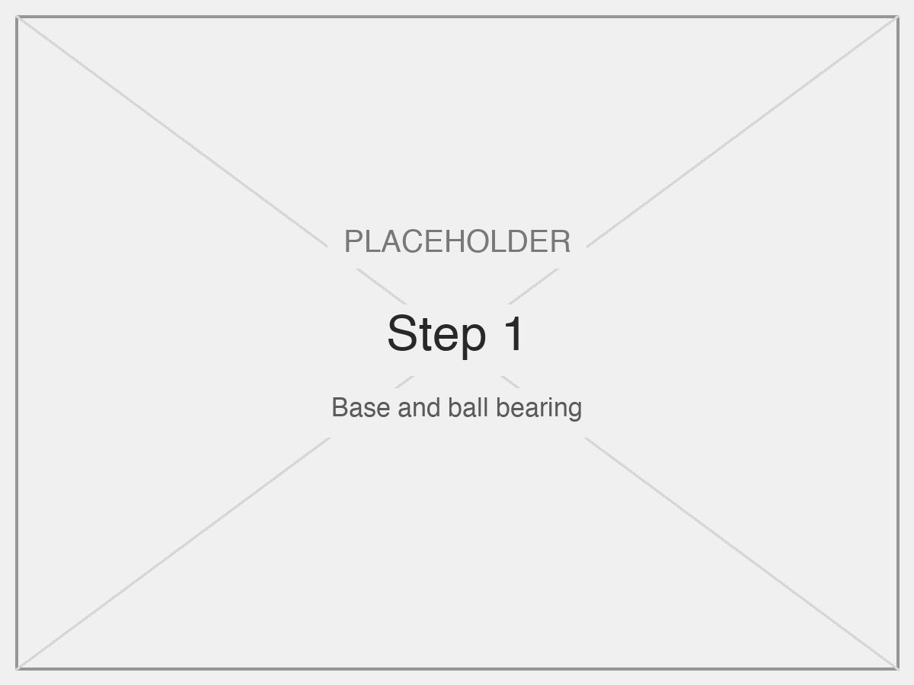 Place the lower bearing ring in the base and fill its groove with the steel balls. | **2. Stepper X** 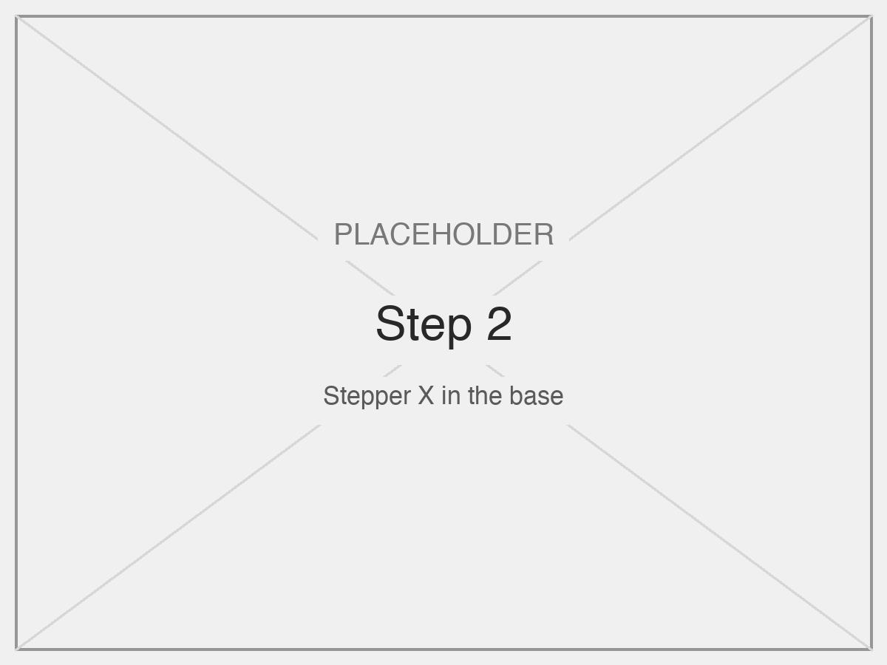 Fix stepper X in its seat, shaft up at the centre. |
| **3. Turntable** 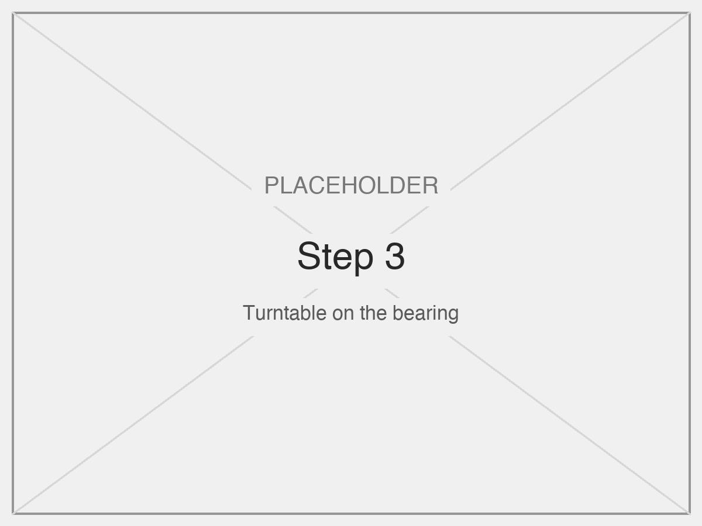 Lower the upper ring onto the balls and couple it to the shaft. It must spin freely by hand. | **4. Electronics** 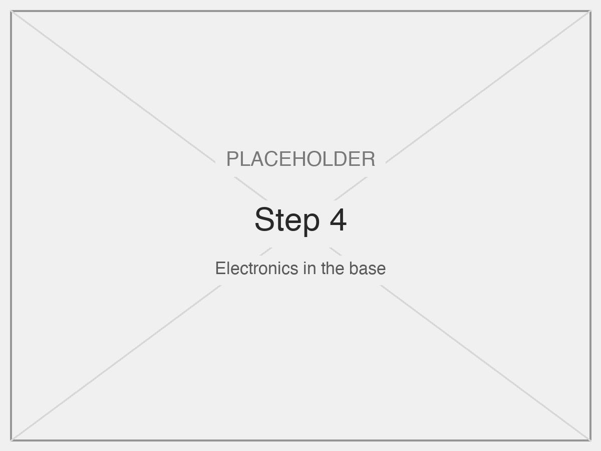 Fix the Arduino, both drivers and the power board in the base. |
| **5. Body** 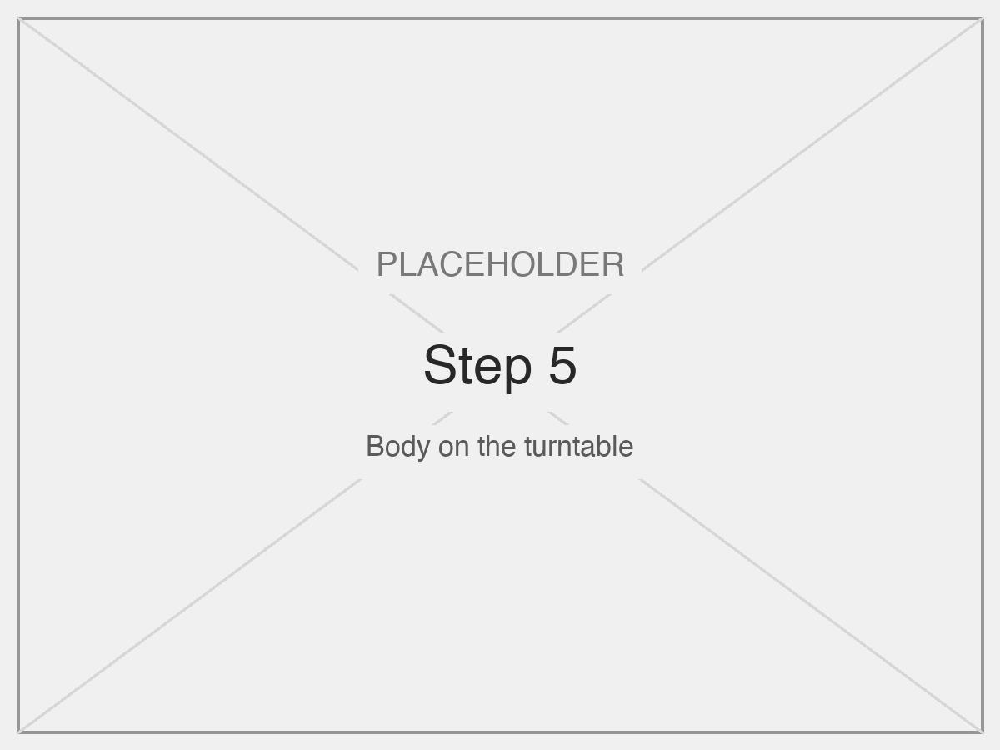 Fix the body to the turntable, with the head cables through its centre. | **6. Stepper Y and cord** 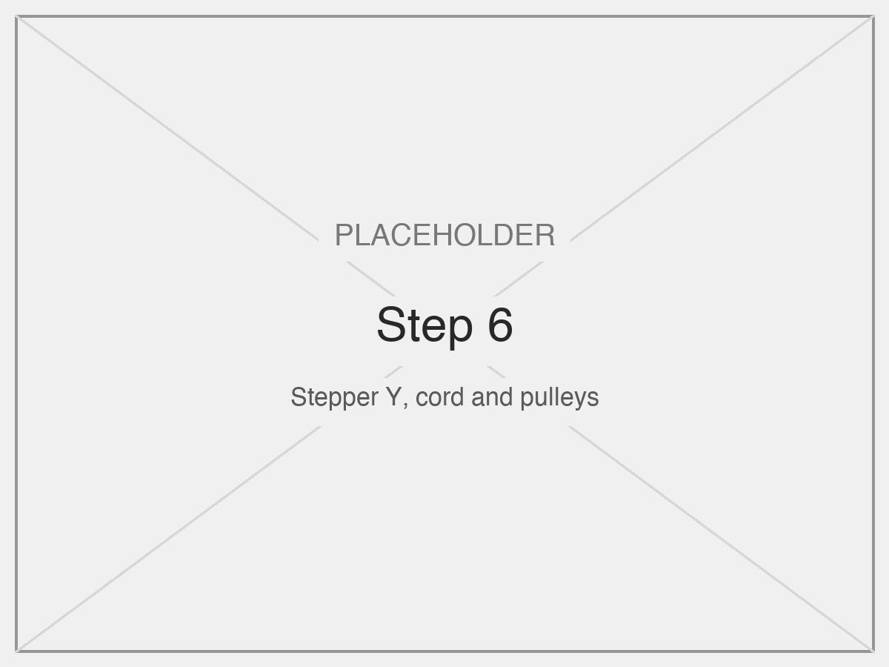 Fit stepper Y and its spool, and thread the cord over the two pulleys. |
| **7. Head** 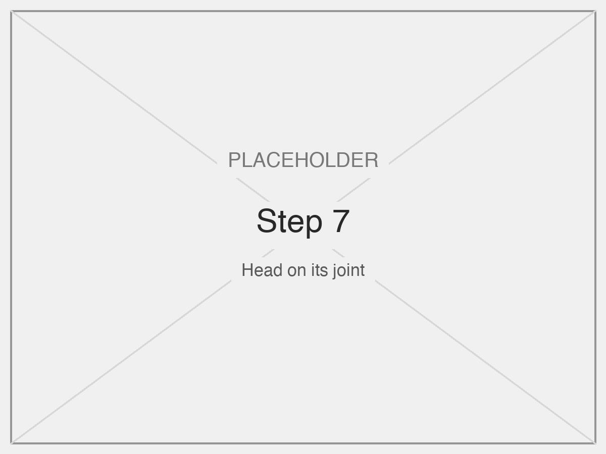 Mount the head on its joint and tie the cord to it. | **8. Servo and rack** 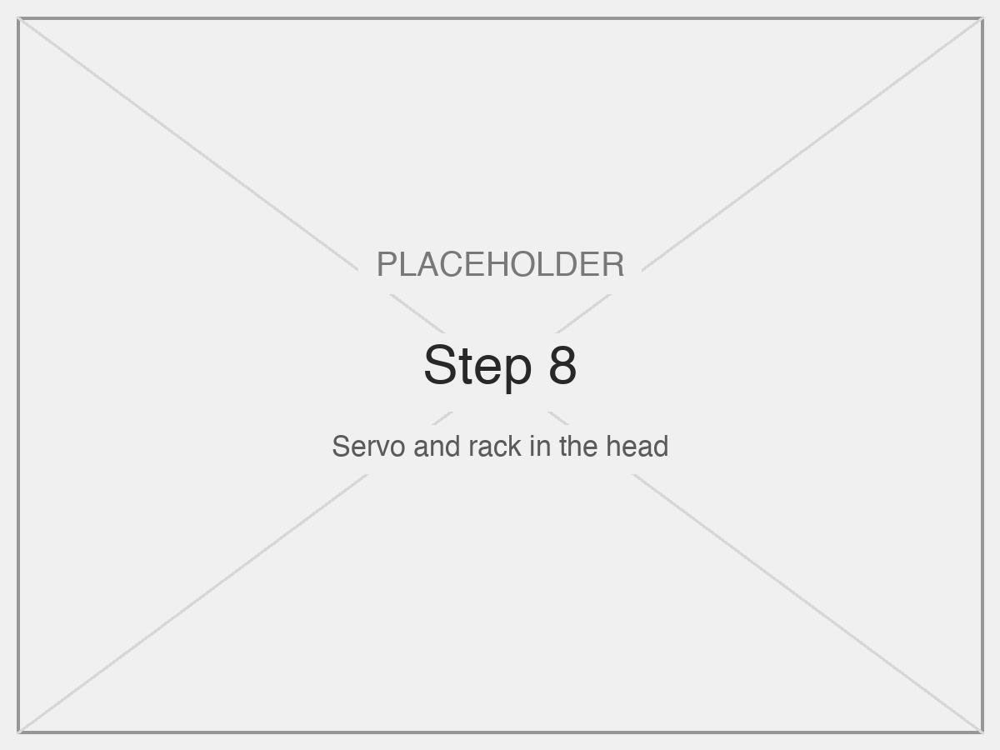 Fix the servo in the head, with the rack pointing at the centre of the mirror. |
| **9. Mirror and LED ring** 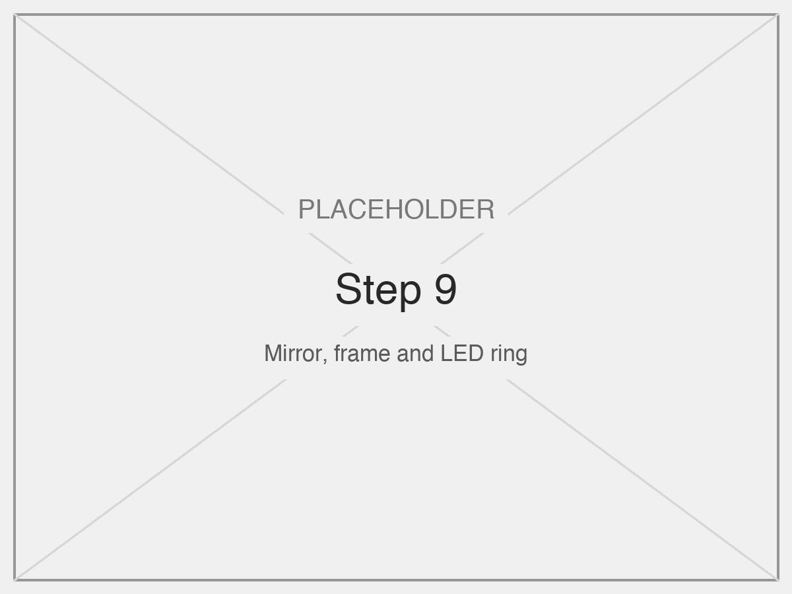 Lay the LEDs in the ring, place the mirror and clamp its rim. | **10. Camera and wiring** 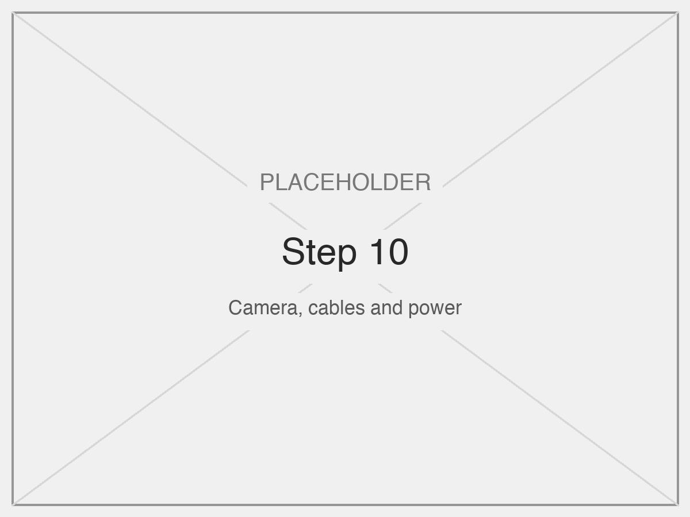 Fix the ESP32-CAM on the head and wire everything as in the [schematic](hardware.md#schematic). |

Then set the limits and speeds with [calibration.md](calibration.md).

## Design process

| Prototype | What we learned |
|---|---|
| 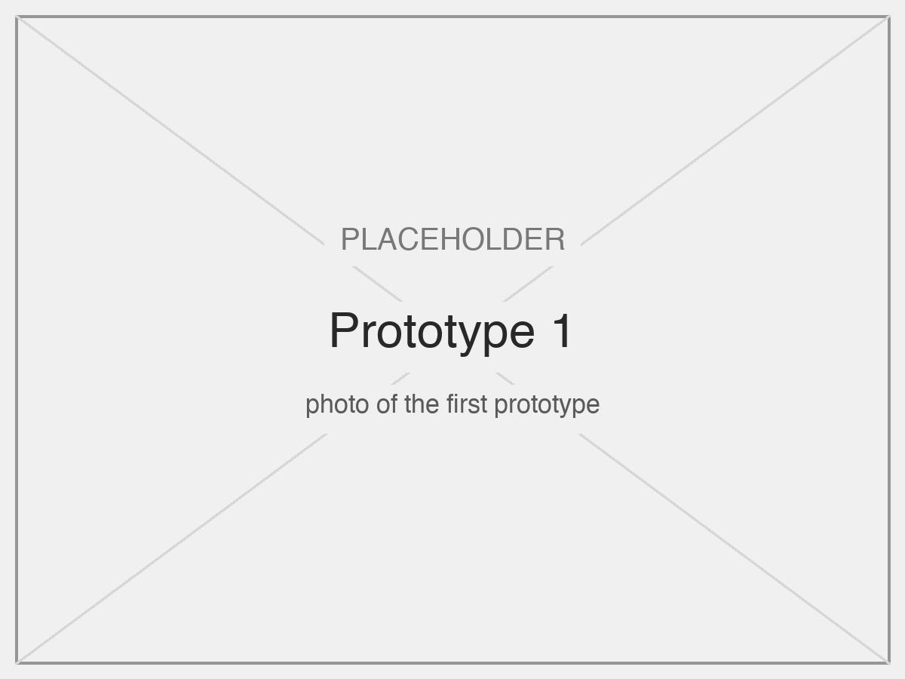 | First proof of concept. The two arms made the structure too heavy |
| 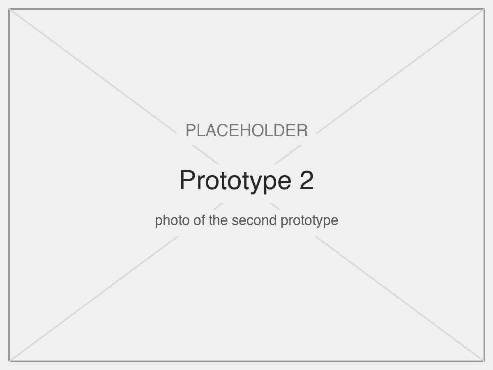 | Wooden version of the final design: too heavy for the stepper motors |
| 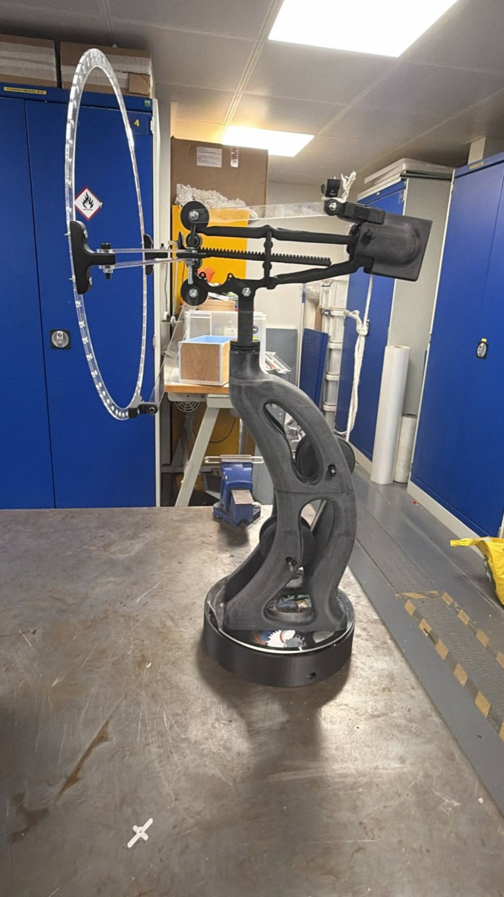 | The final structure before the mirror and LEDs were fitted. It confirmed that both steppers could move the body from inside the base |
