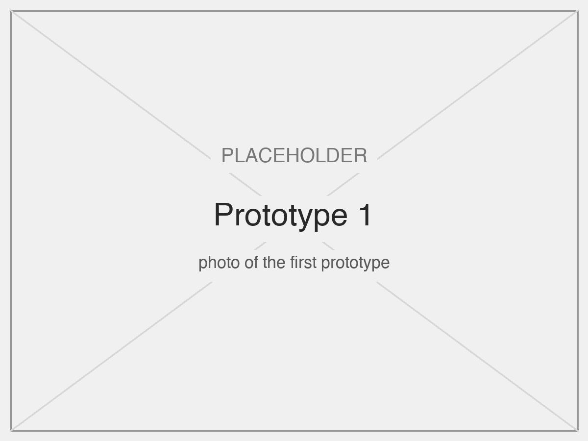

# Mechanical design

Demirah is a new mechanical system. It does not reuse the DE-Arm robot arm, because an arm is the wrong shape for a mirror: we needed a head that turns, nods and changes its own surface.

| | DE-Arm (starting point) | Demirah |
|---|---|---|
| Structure | Open arm of laser-cut plywood | Closed, 3D-printed body with every motor and cable hidden |
| Actuators | 4 hobby servos, one per joint | 2 geared steppers for the large movements, 1 servo for the surface |
| Positioning | Servo steps, limited to 180° | 0.02° per step on the base, 160° of travel, and it holds its place with the power off |
| Load path | Each servo carries the joints after it | Both steppers sit in the base, so the head carries only the mirror, a servo and the camera |
| Output | A gripper moving in space | Rotation, tilt, a deforming mirror surface and a ring of light |

## Mechanisms

The mirror has three degrees of freedom, each with its own actuator.

| Motion | Actuator | Mechanism | Why this mechanism |
|---|---|---|---|
| Rotation of the body | Stepper X, in the base | The body sits on a large ball bearing that we made: steel balls running between two printed rings, like a salad spinner | A wide bearing carries the weight of the body and head without wobbling and with very little friction, so a small 5 V stepper is enough |
| Tilt of the head | Stepper Y, in the base | The stepper winds a cord. The cord runs over **two pulleys** inside the body, up to the head. Gravity pulls the head down, the cord lifts it | The motor's weight stays in the base, so the neck can be slim. The pulleys only redirect the cord around the curve of the body |
| Curvature of the mirror | Servo, in the head | The servo drives a **rack** that pushes the centre of the mirror from behind, while the frame holds its rim | Pushing the centre bends the sheet into a curve. A servo is fast, which allows gestures such as the quick push for a wink |

## Specifications

| Value | Measured |
|---|---|
| Rotation range | 160° (80° each way) |
| Rotation resolution and speed | 50 steps per degree, up to 16° per second |
| Tilt range | 30°, from fully down to fully up |
| Tilt resolution and speed | 250 steps per degree, up to 2.8° per second |
| Surface | From concave to convex, driven by a 1000 µs change of the servo pulse |
| Reaction time | A new expression shows after it has held for 0.3 s (`EMOTION_HOLD_S`) |
| Size | Fits the 605 × 370 × 280 mm project box (TODO: add the measured size) |

The tilt is slow on purpose. A large reduction lets a small 5 V stepper lift the head, and a slow nod looks calm. All values are set in the `CALIBRATE` block of [`mirror.ino`](../arduino/mirror/mirror.ino) and were measured with the procedure in [calibration.md](calibration.md).

## Materials and fabrication

| Part | Material and process | Why |
|---|---|---|
| Base | 3D-printed (TODO: filament) | Hides stepper X, the bearing and the electronics. Printing gives the exact seats for the motor and the bearing races |
| Bearing | Two printed races and steel balls (TODO: number and diameter) | A bearing of this diameter is not a stock part. Printing it into the base costs almost nothing |
| Body | 3D-printed, one curved piece | The organic shape and the internal cord channel cannot be laser-cut. Its openings hold the two pulleys and keep it light |
| Head | 3D-printed | Carries the mirror, the rack, the servo and the camera in one part, which keeps them aligned |
| Mirror frame | Laser-cut acrylic ring | A clean, exact circle that clamps the rim of the mirror, and diffuses the LEDs hidden behind it |
| Mirror | Flexible mirror sheet (TODO: material and thickness) | It must bend without breaking, thousands of times |
| Cord | TODO: type | Low stretch, so the tilt angle stays repeatable |

The printed and cut parts can be reproduced from the CAD files in [`cad/`](../cad) (TODO: add the files), and put together by following [assembly.md](assembly.md).

## Design decisions

- **Camera on the head.** The camera turns with the mirror, so the mirror only has to bring the face to the centre of the image. It does not need exact gear ratios or a calibrated camera (see [software.md](software.md)).
- **Weight kept low.** Both steppers are in the base. This keeps the mirror stable when the head moves, and lets the neck be thin.
- **A cord that only pulls.** Gravity returns the head, so there is no backlash: the cord is always under tension.
- **No end stops.** The position at power-on counts as zero, and software limits stop the motion. This removes switches and wiring from the moving parts.
- **Steppers that hold.** The tilt stepper stays powered to hold the head against gravity. The base stepper rests when it is not moving, because friction holds the base.

## Design process

Earlier versions, and what each one taught us.

| Prototype | What we learned |
|---|---|
|  | TODO: one line. For example: the first mechanism test, and what did not work |
|  | TODO: one line. For example: what changed between the first and the second version |
|  | The full structure before the mirror and LEDs were fitted. It confirmed that both steppers could move the body from inside the base |
