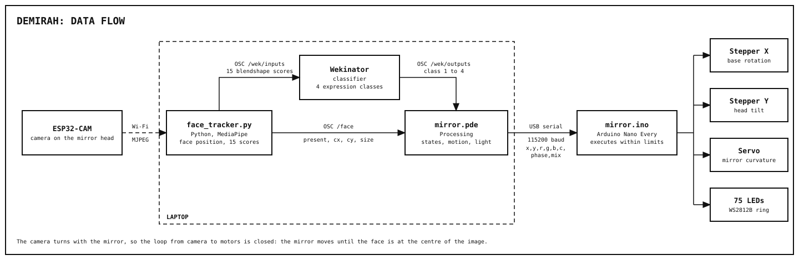

# Software design

| Step | Program | Sends |
|---|---|---|
| Camera | [`esp32_cam/CameraWebServer`](../esp32_cam/CameraWebServer) | MJPEG video over Wi-Fi |
| Perception | [`python/face_tracker.py`](../python/face_tracker.py) | OSC `/face` (position and size of the closest face) to Processing, OSC `/wek/inputs` (15 expression scores) to Wekinator |
| Classification | Wekinator | OSC `/wek/outputs`: class 1 to 4 |
| Behaviour | [`processing/mirror.pde`](../processing/mirror.pde) | One serial line, up to 30 times per second: `x,y,r,g,b,c,phase,mix` |
| Actuation | [`arduino/mirror/mirror.ino`](../arduino/mirror/mirror.ino) | Steps, servo pulse and LED colours |

The product runs from **one Arduino sketch and one Processing sketch**. All states and responses follow each other by themselves; nothing is changed or re-uploaded. How to start it is in the [README](../README.md#running-it).

## Why this pipeline

| Choice | Reason |
|---|---|
| MediaPipe before Wekinator | It turns each image into 15 expression scores, so the model learns expressions, not pixels, and copes with new faces and lighting |
| Wekinator only for the expression | Recognising an expression must be learned from examples. Finding the face does not, so its position goes straight to Processing |
| All behaviour in Processing | One place decides everything, and it can be tested on screen without hardware |
| A simple Arduino | It only executes numbers within safety limits, so it never needs re-uploading |
| Camera on the mirror | Makes the tracking a closed loop, with no cable to the moving head |

## Key algorithms

- **Closed-loop tracking** (`mirror.pde`). The face's offset from the image centre is the pointing error. At each new camera frame the mirror moves a share of the way (`CLOSED_LOOP_GAIN`). Processing never asks for more speed than the motors have, otherwise its estimate of the angle runs ahead of the real mirror and the loop overshoots.
- **Centre box.** The mirror stays still while the face is inside a box at the centre of the image, and re-centres it only when it leaves.
- **State machine.** idle, greeting, tracking and sad. Every change of position, colour and curvature is smoothed, so nothing jumps.
- **Emotion hold.** An expression counts only after Wekinator has reported it for 0.3 s, which removes single-frame errors.
- **Validated serial protocol** (`mirror.ino`). A line with the wrong number of values, or anything that is not a number, is discarded.
- **Servo timer.** Updating 75 LEDs switches interrupts off for about 2 ms, which stretched the Servo library's pulses and made the servo twitch. The pulse is now made by the ATmega4809's timer TCA0 in hardware.

## Sources

All code in this repository is ours, except:

| Source | Used for |
|---|---|
| [DE-Arm](https://github.com/IDE-GID-Cyberphysical-Systems/de-arm) `osc-routing` examples (module) | The starting idea: OSC from Wekinator, through Processing, to the Arduino over serial |
| [Wekinator](http://www.wekinator.org/), Rebecca Fiebrink | The classifier |
| [MediaPipe Face Landmarker](https://ai.google.dev/edge/mediapipe/solutions/vision/face_landmarker), Google | Face landmarks and expression scores, with its pretrained model |
| [OpenCV](https://opencv.org/), [python-osc](https://pypi.org/project/python-osc/), [oscP5](https://sojamo.de/libraries/oscP5/) | Video input and OSC |
| [AccelStepper](https://www.airspayce.com/mikem/arduino/AccelStepper/), [Adafruit NeoPixel](https://github.com/adafruit/Adafruit_NeoPixel) | Stepper control and LEDs |
| Espressif `CameraWebServer` example | The camera stream, unchanged except for the camera model and the Wi-Fi details |
| [ATmega4809 datasheet](https://www.microchip.com/en-us/product/ATMEGA4809) | The servo timer |
